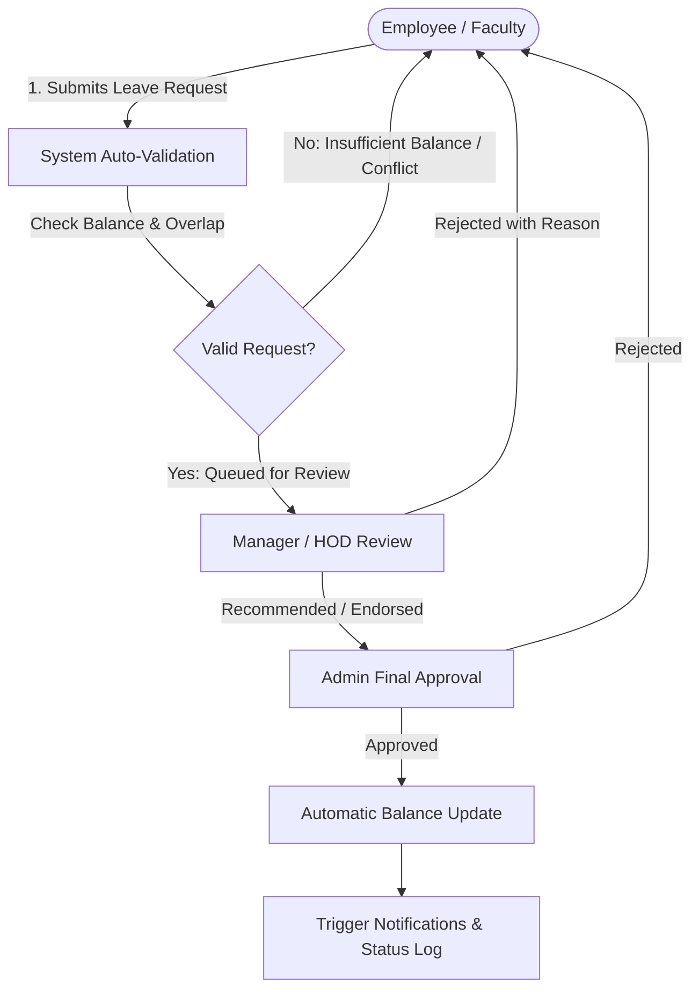

# Smart Leave & Workforce Management System

[](https://nodejs.org/)
[](https://reactjs.org/)
[](https://tailwindcss.com/)
[](https://expressjs.com/)
[](https://www.mongodb.com/)
[](https://jwt.io/)

A modern, full-stack **MERN** application designed to streamline, automate, and digitize organizational leave administration, department reviews, and workforce presence tracking.

---

## Project Overview

The **Smart Leave & Workforce Management System** replaces traditional, error-prone manual paper trails and disjointed email threads with a unified, centralized digital platform. Designed for academic institutions and enterprise workforces, it simplifies the end-to-end leave lifecycle for employees, managers, and institutional leadership.

### Key Value Propositions
- **Centralized Digital Governance:** Eliminates physical paperwork, manual sign-offs, and lost leave records.
- **Hierarchical Approval Chain:** Ensures transparency with automated routing across department heads and central administrators.
- **Accurate Real-Time Tracking:** Provides instant visibility into remaining leave quotas (Casual, Sick, Earned, Duty) without manual ledger calculations.
- **Role-Based Security:** Protects sensitive workforce records using granular role-based access control (RBAC).

---

## Complete System Flow

The platform manages the leave lifecycle through a transparent, automated multi-tier approval pipeline:



### Detailed Workflow Stages

1. **Employee Applies for Leave:**
   - The employee/faculty member logs in, selects the leave category (Casual, Sick, Earned, or Duty), specifies the date range, and provides an optional reason/supporting documentation.
2. **System Auto-Validates:**
   - The backend validates quota balances in real time, checks for conflicting active requests, and verifies date validity before persisting the record with a `Pending` state.
3. **Manager / HOD Reviews:**
   - Department heads receive the application in their review queue to assess departmental workload and staffing coverage, then approve or reject with comments.
4. **Admin Approves:**
   - Institutional administrators perform the final governance check and provide the binding approval.
5. **Balance Updates:**
   - The database atomically deducts approved days from the employee's active leave balance ledger.
6. **Notifications are Triggered:**
   - Status updates are logged, and system alerts notify the employee and relevant stakeholders immediately.

---

## Current Progress (Phase 1 Completed)

The initial foundation and core authentication mechanisms have been fully engineered and tested:

- [x] **MongoDB Database Connection & Schema Design:** Robust data models built using Mongoose, including schemas for `User` profiles (roles, active statuses, default quotas for Casual, Sick, Earned, and Duty leaves) and `Department` structures.
- [x] **JWT-Based Secure Authentication & Role-Based Routing:** Secure login and registration flows powered by `bcryptjs` password hashing, signed JSON Web Tokens (`jsonwebtoken`), and strict role-based access control (RBAC) middleware (`protect` & `authorize`).
- [x] **Responsive React UI with Tailwind CSS:** Clean, glassmorphic visual system built with Tailwind CSS, custom color palettes, reusable interactive modals, and mobile-friendly layouts.
- [x] **Unified Login Gateway & Distinct Role-Based Dashboards:** Single entry point gateway directing authenticated users to tailored interfaces based on assigned permissions:
  - **Faculty Dashboard:** Personal leave balances, recent submissions, and application drawer.
  - **HOD Dashboard:** Departmental overview and pending review queue.
  - **Admin Dashboard:** System-wide management, faculty approval queue, and audit metrics.

---

## Upcoming Features (Phase 2)

Phase 2 expands the platform's automation, intelligence, and reporting capabilities:

- [ ] **Smart Working-Day Calculation:** Intelligent date parsing engine that automatically omits weekends and institutional public holidays from the requested day count.
- [ ] **Team Availability Calendars:** Visual calendar view allowing managers and peers to view scheduled absences across departments to avoid staffing deficits.
- [ ] **Chart.js Analytics:** Interactive data visualizations showcasing monthly leave trends, category distribution, and departmental absenteeism patterns.
- [ ] **Exportable PDF Reports:** One-click generation of printable leave histories, audit trails, and official compliance reports.
- [ ] **Automated Email Notifications:** Transactional email triggers (powered by Nodemailer/SendGrid) for submission confirmations, pending approvals, and status decisions.

---

## UI Screenshots

*Screenshots illustrating the user interface and application workflows:*

### 1. Unified Login Gateway


### 2. Role-Based Dashboard


### 3. Leave Application Modal


### 4. Admin Management & Approval View


> **Image Setup Instructions:**
> - Save your screenshot captures in PNG format inside the `screenshots/` directory at the project root:
>   - `screenshots/login.png`
>   - `screenshots/dashboard.png`
>   - `screenshots/leave-application.png`
>   - `screenshots/admin-approval.png`
> - Recommended resolution: `1920x1080` (or `16:9` aspect ratio) for crisp display.

---

## Tech Stack

### Frontend
- **React.js (v18/v19):** Declarative component-based user interface.
- **Tailwind CSS (v3):** Utility-first styling framework with custom design tokens.
- **Vite:** Next-generation frontend build tooling and rapid Hot Module Replacement (HMR).
- **Lucide React:** Modern, lightweight icon suite.

### Backend
- **Node.js:** Scalable JavaScript runtime environment.
- **Express.js:** Minimalist web framework for RESTful routing and API middleware.
- **JSON Web Tokens (JWT):** Stateless bearer token authentication.
- **Bcrypt.js:** Salted password hashing for credential security.

### Database & ORM
- **MongoDB:** Flexible NoSQL document database for distributed records.
- **Mongoose:** Object Data Modeling (ODM) library for schema validation and database transactions.

---

## How to Run Locally

Follow these step-by-step instructions to set up and run the project in your local development environment.

### Prerequisites
- [Node.js](https://nodejs.org/) (v18.x or later recommended)
- [npm](https://www.npmjs.com/) (v9.x or later)
- [MongoDB](https://www.mongodb.com/try/download/community) installed and running locally on port `27017` (or a remote [MongoDB Atlas](https://www.mongodb.com/atlas) connection URI)
- [Git](https://git-scm.com/)

---

### Step 1: Clone the Repository
```bash
git clone https://github.com/DevForgeX-3/Smart_Faculty_Leave_Management_System.git
cd Smart_Faculty_Leave_Management_System
```

---

### Step 2: Configure Environment Variables (Optional)
The backend is already pre-configured to connect to MongoDB Atlas cloud database by default. If you wish to use a custom `.env` file, copy `.env.example`:

```bash
# On Windows (PowerShell)
Copy-Item .env.example .env

# On macOS / Linux
cp .env.example .env
```

---

### Step 3: Install Dependencies

```bash
# 1. Install root backend dependencies
npm install

# 2. (Optional) Install client frontend dependencies for development
npm install --prefix client
```

---

---

### Step 4: Start the Application

#### Option A: Unified Full-Stack Application (Recommended)
You can start the full application immediately with:

```bash
npm start
```

This starts the Express API server and serves the production-ready React client at **`http://localhost:5000`**.

If you wish to run in developer live-reload mode (Vite + Express concurrently):
```bash
npm run dev
```
- **Frontend Live Dev Server:** `http://localhost:5173`
- **Backend API Server:** `http://localhost:5000`

---

#### Option B: Standalone Modular Backend Service (`smart-faculty-leave/server`)
For microservice / modular backend development:
```bash
cd smart-faculty-leave/server
npm install
node seed.js    # Seed sample departments, users, and leave types
npm run dev     # Starts server on port 5000 with nodemon
```

---

### Step 5: Demo Login Credentials

The system includes pre-seeded and verified accounts across all organizational tiers:

| Role | Email | Password | Access Level |
| :--- | :--- | :--- | :--- |
| **Faculty Member** | `faculty@college.edu` | `Faculty@123` | Apply leave, track balances, view colleague proxy coverage |
| **Department HOD** | `hod@college.edu` | `Hod@123` | Department review queue, approve/reject leaves with remarks |
| **Administrator** | `admin@college.edu` | `Admin@123` | System governance, department management, user approvals |

> **Tip:** You can also click the quick **1-Click Demo** buttons on the login screen for instant credential autofill and access!

---

### Step 6: Access & Verification Endpoints

- **Interactive Web Application:** [`http://localhost:5000`](http://localhost:5000) (or `http://localhost:5173` in dev mode)
- **API Health Check:** [`http://localhost:5000/api/health`](http://localhost:5000/api/health)
- **Departments Directory:** [`http://localhost:5000/api/departments/public`](http://localhost:5000/api/departments/public)
- **System Documentation Endpoint:** [`http://localhost:5000/api`](http://localhost:5000/api)

---

## API Endpoints Overview

| Method | Endpoint | Description | Access |
| :--- | :--- | :--- | :--- |
| `POST` | `/api/auth/register` | Register new faculty/staff account | Public |
| `POST` | `/api/auth/login` | Authenticate user & issue JWT | Public |
| `GET` | `/api/auth/me` | Fetch current authenticated user profile | Private |
| `GET` | `/api/departments/public`| List departments with HOD status | Public |
| `GET` | `/api/departments/:name/faculty`| List faculty for selected department | Private |
| `GET` | `/api/leaves/my-leaves` | Get authenticated user's leaves | Private |
| `POST` | `/api/leaves/apply` | Submit new leave application | Private |
| `GET` | `/api/leaves/department` | Get pending department leave requests | HOD / Admin |
| `PATCH` | `/api/leaves/:id/status` | Approve or reject leave request | HOD / Admin |
| `PATCH` | `/api/leaves/:id/cancel` | Cancel pending leave request | Faculty |
| `GET` | `/api/leaves/all` | View institution-wide leave registry | Admin |

---

## License

This project is licensed under the [ISC License](LICENSE).
